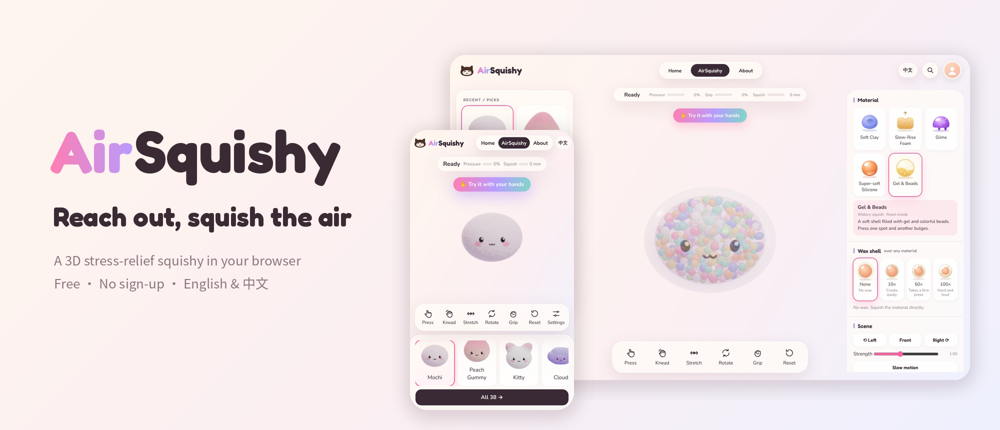
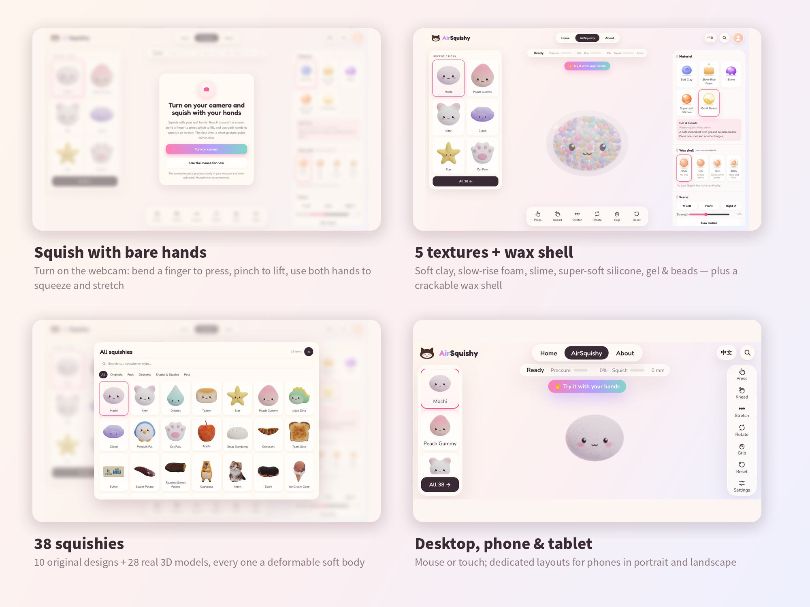
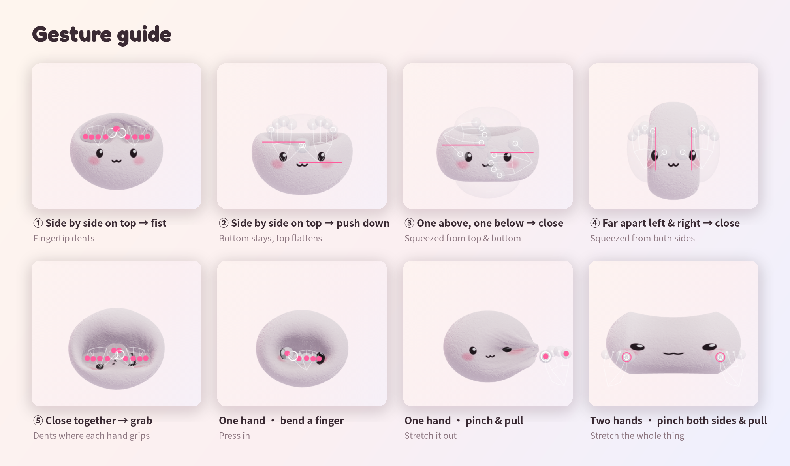
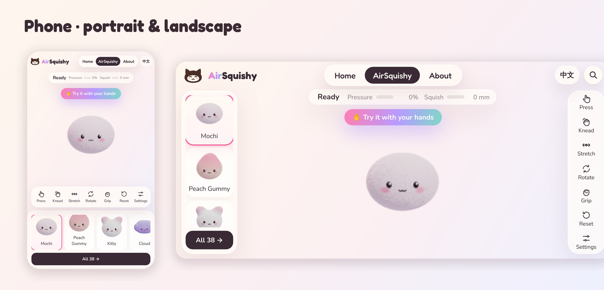
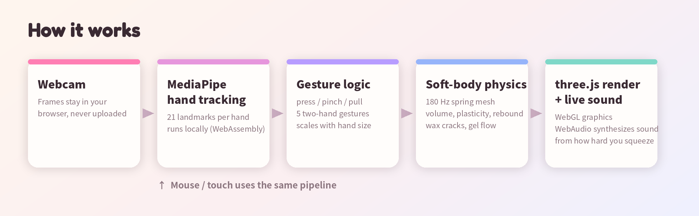

<p align="center"></p>

<p align="center">
  <a href="README.md">中文</a> · <b>English</b>
</p>

<p align="center">
  <b>A 3D stress-relief squishy that runs in your browser. Turn on your webcam and squeeze it with your bare hands, in thin air.</b><br>
  Free · No sign-up · Desktop / phone / tablet · English & 中文
</p>

<p align="center">
  <a href="#try-it">Try it</a> ·
  <a href="#how-to-play">How to play</a> ·
  <a href="#gesture-guide">Gestures</a> ·
  <a href="#how-it-works">How it works</a> ·
  <a href="#privacy">Privacy</a> ·
  <a href="#copyright--license">License</a>
</p>

---

## Why I made this

Squishies are great for stress, but real ones get dirty, break, and you can't carry dozens of textures around. AirSquishy is a squishy that never breaks: open a web page and squish it, no space, no cost. Reach out and press, pinch, pull and squeeze it in thin air. When study or work gets tiring, take a minute or two and let your mind go soft.

— Caroline

## Try it

👉 **https://airsquishy.pages.dev** (hosted on Cloudflare Pages, see [Deploy](#deploy))

> Works best in Chrome, Edge or Safari on a computer with hardware acceleration turned on. Headphones make it extra satisfying.

## Features

<p align="center"></p>

- **✋ Squish with your bare hands**: turn on the webcam; bend a finger to press, pinch thumb and index to lift, move while pinching to pull. Use both hands to squeeze, flatten and stretch. A 5-step gesture guide runs the first time.
- **🎨 5 textures**: soft clay (keeps its shape), slow-rise foam (slowly puffs back in 3–6 s), slime (flows and strings), super-soft silicone (bouncy), gel & beads (a soft shell full of gel and colored beads). Add a 10× / 50× / 100× wax shell that cracks when you squeeze.
- **🧸 38 squishies**: 10 original designs + 28 real 3D models (fruit, desserts, snacks, pets). Every one is a deformable soft body; some even burst with juice or ooze syrup.
- **🔊 Live sound**: synthesized in real time from how hard and how fast you squish, with a different voice for each texture.
- **🖱 Mouse & touch too**: hold to press deeper, drag to stretch, right-click or Space to squeeze the whole thing; two fingers on a phone.
- **📱 Made for phones and tablets**: dedicated portrait and landscape phone layouts; tablets held upright switch to the phone layout.
- **🌏 English & Chinese**: picked from your browser language, switch any time at the top right.

## How to play

| Mode | What to do |
|---|---|
| ✋ Hands (recommended) | Click "Squish with your hands" → allow the camera → reach toward the screen. Bend a finger = press, pinch = lift, pinch and move = pull |
| 🙌 Two hands | Close in from left & right = side squeeze; one above, one below = top-bottom squeeze; push down from above = flatten; pinch both sides and pull apart = stretch |
| 🖱 Mouse | Hold still to press deeper; hold and drag to stretch; right-click or Space to squeeze it all; drag empty space to rotate, scroll to zoom |
| 👆 Touch | One finger to press and drag; two fingers to squeeze or pull apart |

## Gesture guide

<p align="center"></p>

Gesture ranges adapt to how big your hands look on camera, so gestures keep working when the squishy has been squeezed small or your hands are close to the lens. It also copes when the tracker mixes up your left and right hands.

## Phones & tablets

<p align="center"></p>

## How it works

<p align="center"></p>

- **Hand tracking**: [MediaPipe Hand Landmarker](https://ai.google.dev/edge/mediapipe/solutions/vision/hand_landmarker), running locally in the browser via WebAssembly, 21 landmarks per hand. The tracker and model ship with the site itself, so nothing depends on Google's servers (it works in mainland China too).
- **Soft-body physics**: a custom spring-mesh soft body stepped 180 times per second, with volume preservation, plasticity (clay), memory rebound (foam), viscous flow and strings (slime), internal gel flow and wax-shell cracking.
- **Rendering**: [three.js](https://threejs.org/) (WebGL). Resolution drops automatically on slow machines, and the site warns you if hardware acceleration is off.
- **Sound**: synthesized live with WebAudio, timed by real elapsed time so it stays full and smooth even when the frame rate drops.
- **No backend**: the whole site is static files; no server, database or accounts.

## Privacy

- 📷 Camera frames are processed **only inside your browser** to find your hands; nothing is recorded, uploaded or stored. Turning the camera off stops it immediately.
- 🙅 No accounts, no names or emails collected.
- 💾 Only small preferences ("tutorial done", "recently squished", language) are kept in your own browser; clearing site data removes them.

## Project layout

```
site/                 ← the deployable website (publish this folder)
  index.html          ← the app (UI, physics, rendering, sound, i18n)
  vendor/tasks-vision ← hand-tracking runtime (MediaPipe, loaded only when the camera turns on)
  models/             ← hand-tracking model hand_landmarker.task
  fonts/              ← self-hosted fonts (no Google Fonts)
  _headers            ← Cloudflare Pages cache & permission headers
src/
  engine/engine.html  ← physics, rendering, gestures, sound, data for all 38 shapes
  ui/                 ← interface: style.css, body.html, ui.js, pre.js, i18n.js
  i18n/               ← Chinese–English dictionary (baked in at build time)
tools/
  build.py            ← builds site/index.html from src/
  make_docs_images.py ← generates the images in this README
docs/images/          ← README images (one set per language)
```

Rebuild the site:

```bash
python3 tools/build.py      # writes site/index.html
```

## Deploy

The site is plain static files; publish the `site/` folder. It is set up for **Cloudflare Pages**:

1. In [Cloudflare](https://dash.cloudflare.com/) go to Workers & Pages → Create → Pages → **Connect to Git** and pick this repository.
2. Build settings: Framework preset **None**, Build command **empty**, Build output directory **`site`**.
3. Save; it deploys automatically, and every push to `main` redeploys.
4. (Recommended) Add your own domain under Custom domains; it is more reliable from mainland China than the default `*.pages.dev`.

> About mainland China: the site does not depend on any blocked service (fonts, hand-tracking runtime and model are all self-hosted). Speed and reachability of overseas hosting from mainland China can't be guaranteed, though; for reliable access there you need an ICP-registered domain and a mainland CDN.

## Browser support

| Browser | Mouse / touch | Hands (webcam) |
|---|---|---|
| Chrome / Edge (desktop, Android) | ✅ | ✅ |
| Safari (Mac, iPhone, iPad) | ✅ | ✅ |
| Firefox | ✅ expected (not yet fully tested on real devices) | ✅ expected (same) |

Requires WebGL 2. Best with hardware acceleration on; the site tells you if it's off.

## Credits

- The 10 original designs (Mochi, Kitty, Droplet, Toasty, Star, Peach Gummy, Little Dino, Cloud, Penguin, Cat Paw) are by Caroline.
- The other 28 3D models come from creators on Sketchfab and Poly Haven, converted into deformable meshes, some recolored or reproportioned. Full list in [THIRD_PARTY.md](THIRD_PARTY.md); the About page lists them too.
- [three.js](https://threejs.org/) (MIT), [MediaPipe](https://github.com/google-ai-edge/mediapipe) (Apache 2.0), fonts Fredoka, Nunito, Syne, Space Mono, IBM Plex Mono, ZCOOL KuaiLe (SIL OFL).

## Copyright & License

**© 2026 Caroline · AirSquishy. All rights reserved.**

This repository is public to showcase the work and make feedback easy. **It is not open source.** Without written permission you may not copy, modify or redistribute the code, original designs or interface design, and you may not use any of it commercially. See [LICENSE](LICENSE) for the full terms. Third-party libraries, models and fonts belong to their authors and are used under their own licenses; see [THIRD_PARTY.md](THIRD_PARTY.md).

## Contact

Found a bug, want a new squishy, or want to collaborate? Reach out:

- Email: cliu1226@gmail.com
- RedNote (Xiaohongshu): 103775665
- X: [@Carolineliv0](https://x.com/Carolineliv0)

If AirSquishy helped you relax for a moment, you can [buy it a bubble tea on Ko-fi](https://ko-fi.com/caroline1024) or [support on Afdian](https://afdian.com/u/857b4802d6e511f18b5452540025c377) 🧋
