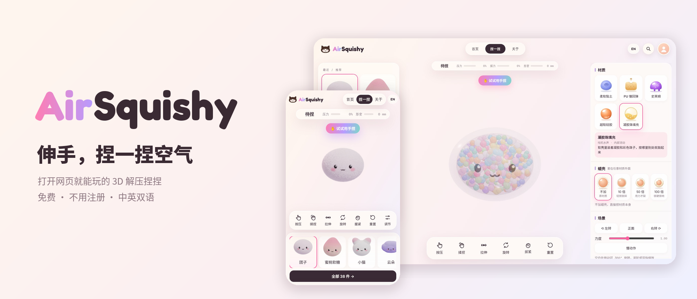
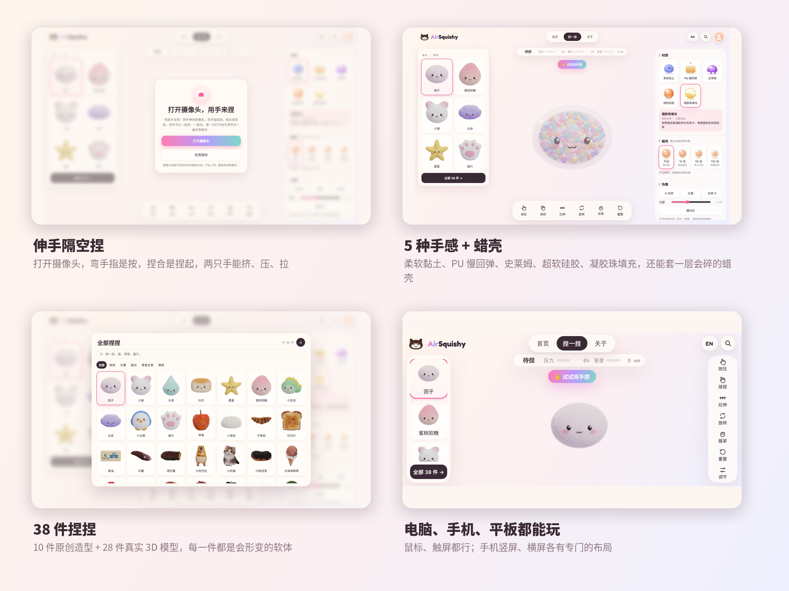
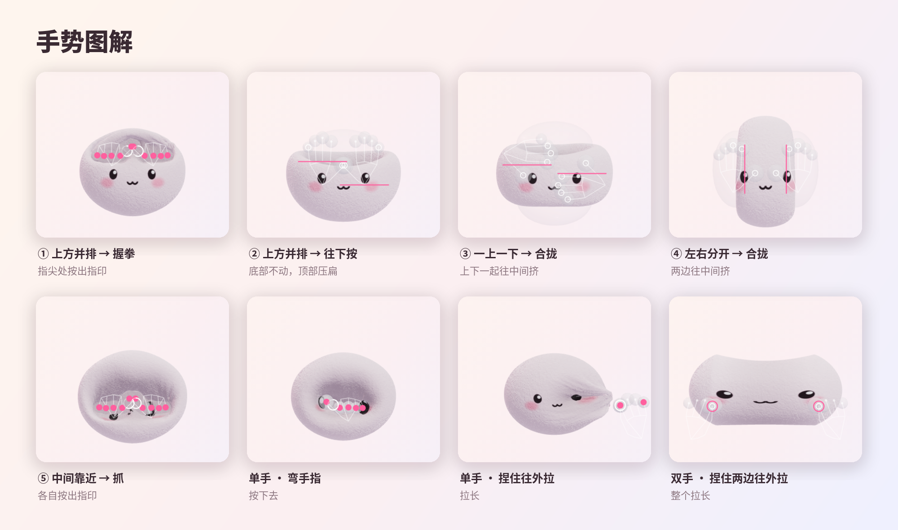
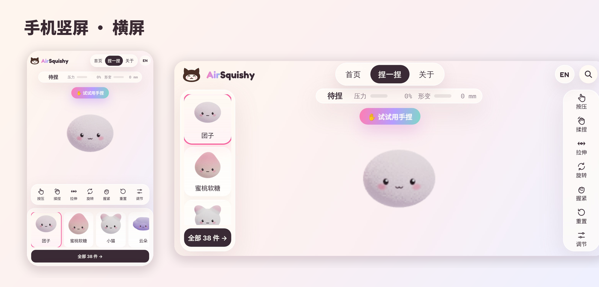
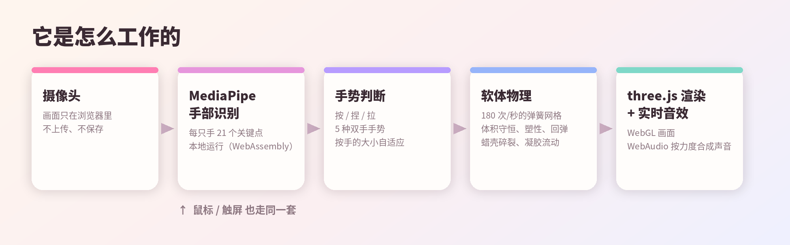

<p align="center"></p>

<p align="center">
  <b>中文</b> · <a href="README.en.md">English</a>
</p>

<p align="center">
  <b>打开网页就能玩的 3D 解压捏捏。打开摄像头，伸手隔空就能按、捏、拉、挤。</b><br>
  免费 · 不用注册 · 电脑 / 手机 / 平板 · 中英双语
</p>

<p align="center">
  <a href="#在线体验">在线体验</a> ·
  <a href="#怎么玩">怎么玩</a> ·
  <a href="#手势图解">手势图解</a> ·
  <a href="#它是怎么工作的">技术结构</a> ·
  <a href="#隐私">隐私</a> ·
  <a href="#版权与授权">版权与授权</a>
</p>

---

## 为什么做这个网站

捏捏乐很解压，但真的捏捏会脏、会坏，也没法随身带上几十种手感。AirSquishy 想做一个「永远捏不坏」的虚拟捏捏：打开网页就能捏，不占地方、不花钱；伸出手，隔空就能按、捏、拉、挤。学习、工作累了的时候，花一两分钟捏一捏，让脑袋放空一下。

— Caroline

## 在线体验

👉 **https://airsquishy.pages.dev**（部署在 Cloudflare Pages，见 [部署](#部署)）

> 建议用电脑上的 Chrome、Edge 或 Safari 打开，并开启浏览器的「硬件加速」；戴上耳机，声音更治愈。

## 功能一览

<p align="center"></p>

- **✋ 伸手隔空捏**：打开摄像头，弯手指是按，拇指和食指捏合是捏起，捏住再移动是拉；两只手还能一起挤、压、拉。第一次会有 5 步手势教学。
- **🎨 5 种手感**：柔软黏土（塑形不回弹）、PU 慢回弹（3～6 秒慢慢鼓回来）、史莱姆（流动、拉丝）、超软硅胶（Q 弹）、凝胶珠填充（软壳里有凝胶和彩色珠子）。还能套一层 10 / 50 / 100 倍厚度的蜡壳，一捏就碎。
- **🧸 38 件捏捏**：10 件原创造型 + 28 件真实 3D 模型（水果、甜点、零食、萌宠），每一件都是能形变的软体，有的还会爆汁、拉出糖浆。
- **🔊 实时音效**：声音按你用了多大的力、搓得多快实时合成，每种材质都有自己的声音。
- **🖱 鼠标 / 触屏也能玩**：按住越按越深，按住拖动拉长，右键或空格整团握紧；手机上两根手指可以一起捏。
- **📱 手机、平板专门排版**：手机竖屏、横屏各有一套布局，平板竖着拿也会自动用手机布局。
- **🌏 中英双语**：按浏览器语言自动选择，右上角可以随时切换。

## 怎么玩

| 方式 | 操作 |
|---|---|
| ✋ 用手捏（推荐） | 点「伸手捏一捏」→ 允许使用摄像头 → 把手伸到屏幕前。弯手指 = 按，拇指食指捏合 = 捏起，捏住移动 = 拉 |
| 🙌 双手 | 两只手从两侧合拢 = 左右挤；一上一下合拢 = 上下挤；在上方往下按 = 压扁；两只手捏住两边往外拉 = 拉长 |
| 🖱 鼠标 | 按住不动越按越深；按住拖动拉长；右键或空格整团握紧；空白处拖动旋转，滚轮缩放 |
| 👆 触屏 | 单指按、拖；两根手指一起按或往外拉 |

## 手势图解

<p align="center"></p>

手势判断会按「你的手在画面里有多大」自动调整范围：捏捏被捏小了、或者手离镜头很近时，手势照样有效。左右手被识别反了也不影响。

## 手机、平板

<p align="center"></p>

## 它是怎么工作的

<p align="center"></p>

- **手部识别**：[MediaPipe Hand Landmarker](https://ai.google.dev/edge/mediapipe/solutions/vision/hand_landmarker)，用 WebAssembly 在浏览器本地运行，每只手 21 个关键点。识别程序和模型都放在网站自己的文件里，不依赖谷歌服务器，中国大陆也能用。
- **软体物理**：自己写的弹簧网格软体，每秒计算 180 次；包含体积守恒、塑性（黏土）、记忆回弹（PU）、黏流与拉丝（史莱姆）、内部凝胶流动、蜡壳碎裂。
- **渲染**：[three.js](https://threejs.org/)（WebGL）。机器跑不动时会自动降低清晰度；浏览器没开硬件加速时会提示用户。
- **音效**：WebAudio 实时合成，按真实经过的时间发声，机器卡的时候声音也不会变小、变断。
- **没有后端**：整个网站是静态文件，不需要服务器、数据库或账号。

## 隐私

- 📷 摄像头画面**只在你的浏览器里**实时识别手的位置，不录像、不上传、不保存；关掉摄像头就立刻停止。
- 🙅 不需要账号，不收集姓名、邮箱等个人信息。
- 💾 只在你自己的浏览器里记住「做过教学没有」「最近捏过哪几个」「语言选择」，清除浏览器数据就没了。

## 项目结构

```
site/                 ← 部署用的网站（直接发布这个文件夹）
  index.html          ← 网页本体（界面、物理、渲染、音效、双语）
  vendor/tasks-vision ← 手势识别程序（MediaPipe，打开摄像头时才下载）
  models/             ← 手势识别模型 hand_landmarker.task
  fonts/              ← 网站自带的字体（不连谷歌字体）
  _headers            ← Cloudflare Pages 缓存和权限设置
src/                  ← 源文件
  engine/engine.html  ← 物理、渲染、手势、音效、38 件造型数据
  ui/                 ← 界面：style.css、body.html、ui.js、pre.js、i18n.js
  i18n/               ← 中英对照表（构建时写进网页）
tools/
  build.py            ← 用 src/ 生成 site/index.html
  make_docs_images.py ← 生成本说明里的图
docs/images/          ← 说明图（中英文各一套）
```

重新生成网站：

```bash
python3 tools/build.py      # 输出 site/index.html
```

## 部署

网站是纯静态文件，直接发布 `site/` 文件夹即可。现在用的是 **Cloudflare Pages**：

1. 登录 [Cloudflare](https://dash.cloudflare.com/) → Workers & Pages → Create → Pages → **Connect to Git**，选择这个仓库。
2. 构建设置：Framework preset 选 **None**，Build command **留空**，Build output directory 填 **`site`**。
3. 保存后会自动发布，之后每次推送到 `main` 分支都会自动更新。
4. （建议）在 Custom domains 里绑定自己的域名：比默认的 `*.pages.dev` 在中国大陆访问更稳定。

> 关于中国大陆访问：网站本身不依赖任何被墙的服务（字体、手势模型、识别程序都在网站自己的文件里）。但海外托管在大陆的速度和稳定性无法保证；如果需要大陆稳定访问，需要使用已备案域名 + 国内节点。

## 浏览器支持

| 浏览器 | 鼠标 / 触屏 | 用手捏（摄像头） |
|---|---|---|
| Chrome / Edge（电脑、安卓） | ✅ | ✅ |
| Safari（Mac、iPhone、iPad） | ✅ | ✅ |
| Firefox | ✅ 应该可用（还没在真机上完整测试） | ✅ 应该可用（同左） |

需要支持 WebGL 2 的浏览器。开启「硬件加速」体验最好；没开时网站会提示。

## 致谢

- 10 件原创造型（团子、小猫、水滴、吐司、星星、蜜桃软糖、小恐龙、云朵、小企鹅、猫爪）由 Caroline 设计。
- 另外 28 件 3D 模型来自 Sketchfab 和 Poly Haven 上的创作者，已转换成可形变的网格，部分重新上色或调整了比例。完整名单见 [THIRD_PARTY.md](THIRD_PARTY.md)，网站「关于」页也会列出。
- [three.js](https://threejs.org/)（MIT）、[MediaPipe](https://github.com/google-ai-edge/mediapipe)（Apache 2.0）、字体 Fredoka、Nunito、Syne、Space Mono、IBM Plex Mono、站酷快乐体（SIL OFL）。

## 版权与授权

**© 2026 Caroline · AirSquishy。保留所有权利。**

本仓库公开，是为了展示作品和方便反馈，**不是开源授权**。未经书面许可，不得复制、修改、再发布本项目的代码、原创造型和界面设计，也不得用于任何商业用途。详细条款见 [LICENSE](LICENSE)。第三方库、模型和字体的版权归原作者所有，按各自的授权使用，见 [THIRD_PARTY.md](THIRD_PARTY.md)。

## 联系

发现 bug、想要新的捏捏、或者想聊合作，都欢迎来找我：

- Email：cliu1226@gmail.com
- 小红书：103775665
- X：[@Carolineliv0](https://x.com/Carolineliv0)

如果 AirSquishy 让你放松了一会儿，欢迎 [在爱发电请它喝杯奶茶](https://afdian.com/u/857b4802d6e511f18b5452540025c377) 或 [在 Ko-fi 支持](https://ko-fi.com/caroline1024) 🧋
